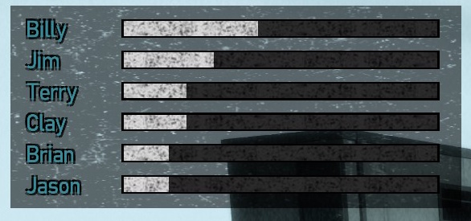

# LoadoutTabFix

A small QoL compatibility patch for TLAD and [Liberty Loadout](https://www.nexusmods.com/gta4/mods/1226). It moves the game's Tab action, the TLAD club member list, to **F6**, so LibertyLoadout's weapon and radio wheels can keep Tab.

Setup when written:

| Component | Version | Released |
|---|---|---|
| GTA IV Complete Edition (Steam) | 1.2.0.59 | - |
| [FusionFix](https://github.com/ThirteenAG/GTAIV.EFLC.FusionFix/releases/tag/v5.1.1) | 5.1.1 | 1 Oct 2026 |
| [Gillian's Liberty Drag-and-Drop](https://gillian-guide.github.io/drag-and-drop-archive/) | 2.11.2026 | 2 Nov 2026 |
| [Liberty Loadout](https://www.nexusmods.com/gta4/mods/1226) | 0.19.2 | 31 Oct 2026 |
| [Liberty Shoulder](https://www.nexusmods.com/gta4/mods/1229) | 0.3.0 | 12 Oct 2026 |

## The problem

In TLAD, during missions, Tab toggles an on-screen list (top-left) of club members with a bar for each. Outside missions Tab does nothing in game, so the clash only happens on a job. LibertyLoadout also uses Tab (hold) for its wheels, so opening a wheel toggles the list too. Hitting Tab again to hide the list turns off the radio, and holding Tab to turn the radio back on brings the list back.

<br>
<sub>The TLAD club member list, cropped from the Steam screenshot `20261107163518_1.jpg`.

The list shows how battle hardened (the crew toughness stat) each Lost member on the job is. The game's own help text confirms the key: "At any time during a job press TAB to view how battle hardened the Lost gang members with you are." No manual or controls document mentions it, though. The full write-up, with sources and in-game findings, is in [`docs/tlad-tab-list-research.md`](docs/tlad-tab-list-research.md). The list is a base-game feature (i.e., it still appears with `update` and `plugins` renamed). Tab isn't in the controls menu or `ControlMap.dat`, so it can't be rebound in game.

## How it works

The plugin swaps Tab and F6 in what the game sees. F6 looks like Tab and toggles the list. Real Tab no longer reaches the game's Tab action, but plugins that read the keyboard through the Windows API still see it, so the wheels stay on Tab.

From the logs, the game reads the keyboard through DirectInput 8 (Unicode interface, `GetDeviceState` and `GetDeviceData`) and calls `GetKeyboardState`, so those are what get hooked. It doesn't use `GetAsyncKeyState`, `GetKeyState`, key messages or `WM_INPUT` for this. No game files are modified.

## Install

`LoadoutTabFix.asi` and `LoadoutTabFix.ini` go in `GTAIV\plugins`, with Liberty Loadout's `KeyboardWheelKey` and `RadioWheelKey` left at `9` (Tab). F6 then toggles the list and holding Tab opens the wheels. Deleting both files uninstalls it.

`NewKey` in the ini sets the replacement key, as a decimal Windows virtual-key code:

| Key | Code |
|---|---|
| Tab (`GameKey`) | 9 |
| Caps Lock | 20 |
| G | 71 |
| F5 | 116 |
| F6 (default `NewKey`) | 117 |
| F7 | 118 |
| F8 | 119 |

`Log=1` writes `LoadoutTabFix.log`, which shows which input path the game uses. That helps if a game or FusionFix update breaks the plugin. The `[Hooks]` entries stay at their defaults.

The swap hides real Tab from the game entirely, so any other Tab action in menus or minigames now sits on F6. Controllers are unaffected.

The game's one-time help prompt early in TLAD ("At any time during a job press TAB...") still says Tab. Changing it would mean editing the game's text files, which this plugin avoids, so it is left as is.

## Build

`src/LoadoutTabFix.cpp` is the plugin's C++ source. From the repo root, it builds as 32-bit with MinGW-w64:

```sh
i686-w64-mingw32-g++ -O2 -shared -static -static-libgcc -static-libstdc++ \
  -o LoadoutTabFix.asi src/LoadoutTabFix.cpp -ldinput8 -ldxguid -Wl,--kill-at
```
## AI Disclosure

This plugin was written by Claude.
